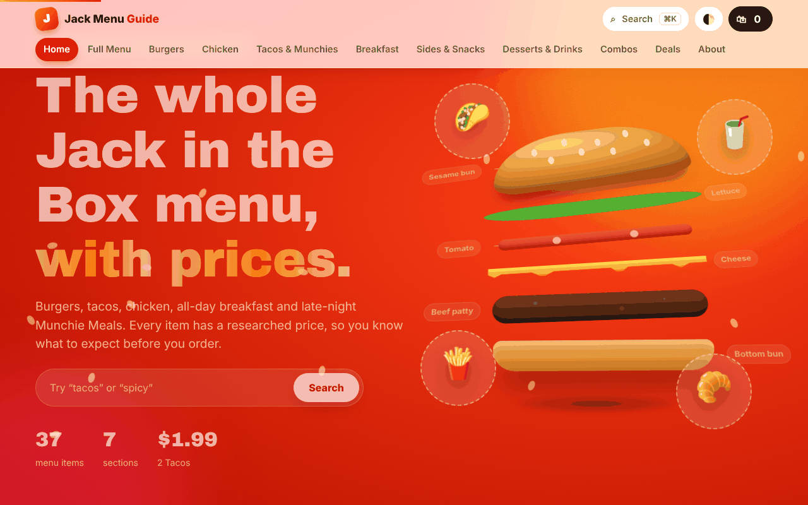

# Jack Menu Guide

An unofficial, fan-made website for the Jack in the Box menu, with researched prices. Plain HTML, CSS and JavaScript, with no build step and no dependencies.

## Features

- **3D hero:** a burger that comes apart layer by layer as you scroll and turns to follow the mouse, with floating food around it and falling sesame seeds.
- **3D tilt cards** with a light glare that follows the cursor, plus floating food images.
- **Scroll animations:** headlines reveal word by word, cards fade in in sequence, numbers count up and a price ticker scrolls across the page.
- **Smooth page transitions** (View Transitions API) and a circular light/dark mode switch.
- **Order cart:** a slide-out drawer, items that fly into the cart, quantity controls and a total with sales tax. Saved in the browser.
- **Quick view** popup for every item, with quantity and add to order.
- **⌘K / Ctrl+K search** across items and pages, with keyboard navigation.
- **Favorites (♥)** with a Favorites filter on the full menu.
- **Full menu tools:** search, section filters, a max-price slider and sorting.
- **Live extras:** a countdown to new launches and a late-night Munchie Meal clock.
- Works on phones, respects reduced-motion settings and supports keyboard use.

> Not affiliated with or endorsed by Jack in the Box Inc. Prices vary by location.



## Pages

| Page | File |
| --- | --- |
| Home | `index.html` |
| Full menu (search, filter, sort) | `menu.html` |
| Burgers | `burgers.html` |
| Chicken | `chicken.html` |
| Tacos & Munchies | `tacos.html` |
| Breakfast | `breakfast.html` |
| Sides & Snacks | `sides.html` |
| Desserts & Drinks | `desserts.html` |
| Combos | `combos.html` |
| Deals & specials | `deals.html` |
| My order (price estimator) | `order.html` |
| About & FAQ | `about.html` |
| Price sources | `sources.html` |
| Not found | `404.html` |

## Adding images

Every picture has a reserved space that shows the file name it's waiting for. Save an image with that name (`.webp` or `.png`) into `assets/img/` and it appears automatically. [`docs/IMAGES.md`](docs/IMAGES.md) lists every file name with a ready-to-use image-generator prompt.

## Updating prices

All menu items, prices and deals live in `assets/menu-data.js`. Each item has a typical `price`, plus optional `low`/`high` values when sources disagreed. Edit that file and every page updates.

Prices were last checked on October 31, 2026. See `sources.html` for where they came from.

## Run locally

```bash
python3 -m http.server 8000
```

Then open http://localhost:8000.

## Deploy

`.github/workflows/pages.yml` publishes the site to GitHub Pages on every push to `main`. Turn on Pages in the repository settings (Source: GitHub Actions).
